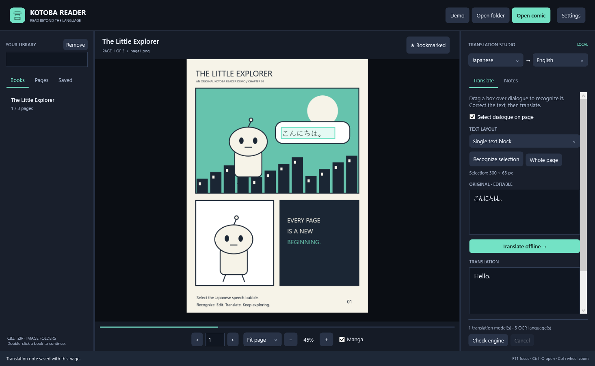

# KotobaReader

[](https://github.com/TaukirA-cloud/KotobaReader/actions/workflows/build.yml)
[](LICENSE)

**Read beyond the language.** A native Windows comic and manga reader with local
OCR, offline neural translation, and page-linked translation notes.



Built with **C# · .NET 10 LTS · WPF · Python · Tesseract · CTranslate2 · SentencePiece**.
No paid API, subscription, account, or GPU required. Internet is needed for initial
engine/model installation; reading and translation then run locally.

## What it does

| Reader | Translation studio |
| --- | --- |
| CBZ/ZIP and nested image folders | Drag to select dialogue and recognize it locally |
| Natural page ordering | Japanese horizontal and vertical OCR layouts |
| Fit page, fit width, actual size, and zoom | Editable original text and translation |
| Manga arrow navigation and F11 focus mode | CPU neural inference with installed language pairs |
| Searchable library and resumed reading | Model-aware local translation cache |
| Bookmarks and page navigation | Saved page-linked notes; Markdown/JSON export |
| Drag-and-drop import | Diagnostics, cancellation, and worker recovery |

PNG, JPEG, BMP, GIF, and TIFF are supported. GIF/TIFF display their first frame.
CBR/RAR, PDF, automatic speech-bubble detection, and replacement lettering on the
artwork are not implemented. This is a working **v0.1 desktop MVP**, not a claim of
professional translation quality or a signed installer.

## Download for Windows

Open [GitHub Releases](https://github.com/TaukirA-cloud/KotobaReader/releases), download
the Windows x64 ZIP, extract it, and double-click **KotobaReader.exe**. The reader
includes its .NET runtime. Keep the companion folders for the optional language
engine setup; OCR and translation dependencies are installed separately.

If a preview release is not listed yet, build from source below. Generated
executables are distributed through Releases rather than committed to this repository.

## Build from source on Windows

Install the [.NET 10 SDK](https://dotnet.microsoft.com/download/dotnet/10.0), then:

```powershell
git clone https://github.com/TaukirA-cloud/KotobaReader.git
cd KotobaReader
./scripts/run.ps1 -Demo
```

The reader works immediately. To add OCR and Japanese→English translation, install
[Python 3.11–3.13 x64](https://www.python.org/downloads/windows/) and run:

```powershell
./scripts/setup-engine.ps1 -InstallTesseract
```

Open the app, click **Check engine**, and select a Japanese bubble in **Demo**.
Use **Single text block** for the demo's horizontal text, review the OCR, then
click **Translate offline**. Save a note to retain it with the page.

See [complete setup and troubleshooting](docs/SETUP.md) for custom paths, manual
OCR installation, additional language pairs, storage, and publishing a portable ZIP.

## Engineering behind the interface

- Async indexing and image decoding with cancellation and generation checks prevent
  older page requests from replacing the newest page.
- A persistent Python process receives JSON-line requests over pipes. Canceling
  inference kills its process tree; the next request starts cleanly.
- Archive pages are streamed without extraction. Expanded byte size, entry counts,
  and decoded dimensions are bounded; corrupt pages can be skipped.
- Bitmap-pixel crop coordinates survive zoom and resizing.
- Atomic JSON saves retain a backup and preserve damaged state during recovery.
- Cache keys separate text, languages, model identity, and pipeline revisions.

Read the [architecture and tradeoffs](docs/ARCHITECTURE.md),
[testing guide](docs/TESTING.md), and [portfolio walkthrough](docs/PORTFOLIO.md).

## Validate and package

```powershell
./scripts/test.ps1                   # Build + core and Python regressions
./scripts/test.ps1 -Ui               # Also exercise and render the actual WPF reader
./scripts/test.ps1 -Integration      # Also run real installed OCR and model inference
./scripts/publish.ps1                # Self-contained Windows x64 reader ZIP
python scripts/check-public-source.py # Check Git candidates for private/generated files
```

The Windows CI workflow runs core, worker, and UI smoke checks and creates a reader
ZIP and screenshot artifact. Full language integration runs locally after model
setup. Test details and coverage limits are in [TESTING.md](docs/TESTING.md).
Release tags build a downloadable preview ZIP and SHA-256 checksum. See
[release publishing](docs/PUBLISHING.md), [changelog](CHANGELOG.md), and
[contributing](CONTRIBUTING.md).

## Keyboard controls

| Key | Action |
| --- | --- |
| Left / Right | Turn pages; reversed in Manga mode |
| Page Up / Page Down | Previous / next page |
| Home / End | First / last page |
| B | Toggle bookmark |
| Ctrl+O | Open comic archive |
| Ctrl+mouse wheel | Zoom |
| F11 | Toggle focus mode |
| Escape | Cancel engine task, clear selection, leave focus mode |

## Honest limits

General-purpose OCR struggles with small lettering, handwriting, furigana, and
sound effects. Local translation models can miss context or mistranslate even
simple phrases. The source text and result stay editable for that reason.
Whole-page OCR does not reconstruct manga reading order, and very tall pages
are downsampled to a bounded preview before recognition.

The project integrates existing models; it does not train them. Generated demo
artwork is original. Personal comics, models, environments, and build outputs are
excluded from Git. See [third-party attribution and provenance](docs/THIRD_PARTY.md).

## License

Project source: [MIT](LICENSE). Engines, model packages, native libraries, and comic
files retain their own terms. Model weights and OCR executables are downloaded
separately and are not included in the repository or portable reader ZIP.
