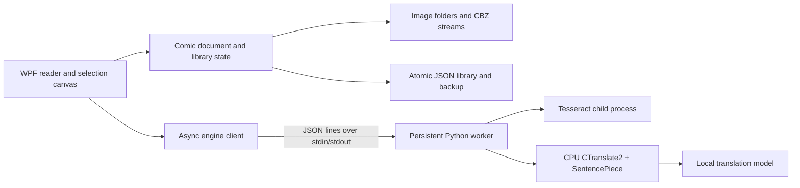

# Architecture and engineering decisions

## Boundaries

- **KotobaReader.Core** contains platform-independent document indexing, natural
  ordering, byte limits, cache identities, and persistence. It has no UI or ML dependencies.
- **KotobaReader** owns WPF presentation, image decoding, selection, keyboard input,
  and asynchronous orchestration. `ReaderViewModel` supplies observable presentation
  state; window code handles view geometry and interaction flows.
- **worker** owns OCR and translation. Its protocol reserves stdout for one JSON
  response per request; library output goes to stderr. It never opens a socket.
- **scripts** perform explicit online provisioning, local validation, and packaging.

## Responsiveness and correctness

Comic indexing and decoding run off the UI thread. Every requested page receives a
generation number; a completed older request cannot replace the newest page. Page
changes cancel active OCR/translation. Translation results also compare their
original text before display so edits made during inference are preserved.

Decoded bitmaps are frozen before crossing WPF thread boundaries. The longest edge
is bounded to 4096 pixels, and only the current page is retained by the reader.
The page list is virtualized. Original full-resolution bytes are not retained in
a second cache. OCR uses the decoded page; this bounds memory but can lose detail
on tall webtoon pages. Selection coordinates are stored in bitmap pixels and are
redrawn using the current scale, so resizing and zooming preserve the selected text.

The engine client serializes access to a persistent process with a semaphore. Each
request has an ID and timeout. Cancellation kills the entire process tree, including
Tesseract, and the next request starts cleanly. This avoids a canceled response being
mistaken for a later response. Native inference stays outside the desktop process.
The worker retains only one translation model at a time and uses CPU int8 inference.

Translation cache identities include the input, language direction, model metadata,
model path/size/modification time, and pipeline revision. The cache has a 1,500-entry
limit. Results with explicit model warnings are not cached. Bookmarks and notes are
separate from the cache, so clearing it never removes user notes.

## Files and failure handling

CBZ files are ZIP streams, not extracted directories. Supported images are sorted
using digit-run comparison without integer conversion, including arbitrarily long
page numbers. Duplicate archive keys are rejected. Entry count, expanded page byte
size, and decoded dimensions are bounded; a corrupt page can be skipped. Junctions
and symlinks are not followed during recursive folder import.

Library writes are flushed to a temporary file and atomically replace the primary
file, retaining one backup. On malformed JSON, a preserved copy is created before
backup recovery. Notes and bookmarks are saved after a short debounce and flushed
when the application closes. Save failures remain visible to the reader.

JSON was chosen over SQLite because the present library is a small, single-writer
document: one user, one window, no simultaneous updates or query-heavy workloads.
It keeps builds dependency-free and backup recovery inspectable. A much larger
library, thumbnail index, or multiple windows would justify SQLite and migrations.

## Translation choices and limits

The application uses Argos-format CTranslate2 model packages directly, with
SentencePiece tokenization. It does not require the Argos Python application,
Stanza, SpaCy, PyTorch, or a web server. The initial ja→en model is version 1.1;
it is a compact general-purpose model, not a model trained by this project.

The bubble pipeline keeps paragraphs separate, rejects sequences over 450 input
tokens, honors optional target prefixes, and uses a 0.2 length penalty. Local
evaluation caught that the library's default penalty mistranslated a greeting;
the known-greeting case now runs through OCR, inference, and the UI cache in the
integration smoke test. Output limits and remaining source script produce warnings.
These checks do not establish translation accuracy across manga genres.

## Verification

Core regression checks use a dependency-free C# executable with named assertions
and a failing exit code. Python uses the standard-library unittest runner. The
Windows smoke executable loads the actual WPF theme/window, generates original
demo artwork, drives reader actions, and renders a screenshot. The opt-in integration
mode calls real installed OCR and model inference, checks a known translation,
verifies caching, cancels active inference, and verifies process recovery.

See [TESTING.md](TESTING.md) for reproducible commands and coverage boundaries.
